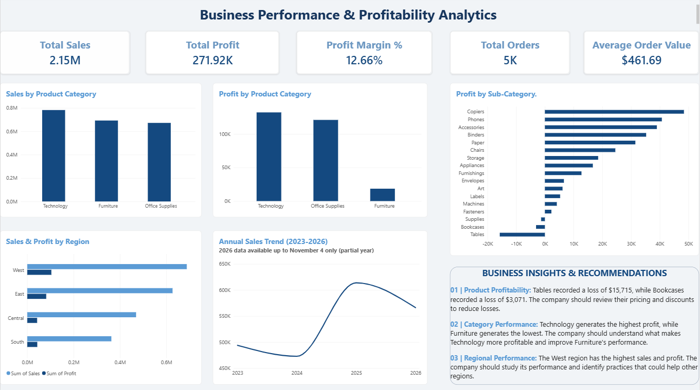

# Business Performance & Profitability Analytics

## Project Overview

This project focuses on analyzing business performance through sales, profit, product, category, and regional data. The objective is to identify profitability trends, evaluate business performance, highlight areas of concern, and generate actionable business recommendations.

The project uses **Microsoft Power BI** for interactive dashboard development, supported by Microsoft Excel and Power Query for data preparation and analysis.

## Dashboard Preview

## Business Objectives

- Evaluate overall sales and profitability.
- Compare sales and profit across product categories.
- Identify profitable and loss-making product sub-categories.
- Analyze regional sales and profit performance.
- Understand annual sales trends.
- Translate analytical findings into actionable business recommendations.

## Tools & Technologies

- **Microsoft Power BI** – Dashboard development and data visualization.
- **Microsoft Excel** – Data exploration and supporting analysis.
- **Power Query** – Data cleaning and transformation.
- **DAX** – Measures and KPI calculations.

## Dataset Information

- **Dataset:** Sample Superstore
- **Source:** Tableau Sample Data
- **Data includes:** Order details, customer information, product categories, sub-categories, geographical regions, sales, quantity, discounts, and profit.
- **Data preparation:** Data was reviewed, cleaned, and transformed using Power Query.
- **Date filter:** The Power BI analysis includes orders placed up to November 4, 2026.

## Key Performance Indicators (KPIs)

| KPI | Result |
|---|---:|
| Total Sales | $2.15M |
| Total Profit | $271.92K |
| Profit Margin | 12.66% |
| Total Orders | 4,651 |
| Average Order Value | $461.69 |

## Dashboard Analysis

The interactive Power BI dashboard contains five key analytical views:

1. **Sales by Product Category:** Compares sales contribution across product categories.
2. **Profit by Product Category:** Evaluates profitability across different categories.
3. **Profit by Sub-Category:** Highlights profitable and loss-making product sub-categories.
4. **Sales & Profit by Region:** Compares business performance across geographical regions.
5. **Annual Sales Trend:** Tracks sales performance from 2023 to 2026.

*Note: The 2026 annual sales data is partial and includes orders only up to November 4, 2026.*

## Key Business Insights

**1. Product Profitability**
- Tables recorded a loss of $15,715.
- Bookcases recorded a loss of $3,071.
- These sub-categories require further review of pricing, discounts, and product costs.

**2. Category Performance**
- Technology generated the highest profit.
- Furniture generated the lowest profit among the product categories.
- Improving Furniture profitability is an area worth investigating.

**3. Regional Performance**
- The West region recorded the highest sales and profit.
- Its performance can be studied to identify practices that may benefit other regions.

## Business Recommendations

- Review pricing, discounts, and product costs for loss-making sub-categories.
- Investigate the factors contributing to stronger Technology profitability.
- Identify opportunities to improve Furniture's profit contribution.
- Study the West region's performance and evaluate practices that could be applied to other regions.

## Repository Contents

| File | Description |
|---|---|
| `business_performance_profitability_analytics.pbix` | Interactive Power BI dashboard file. |
| `business_performance_profitability_analytics_dashboard.png` | Dashboard screenshot and visual preview. |
| `analysis_workbook.xlsx` | Supporting Excel analysis workbook. |
| `sample_superstore.xls` | Sample Superstore source dataset. |

## Project Outcome

This project demonstrates practical skills in data preparation, KPI development, business performance analysis, data visualization, and communicating actionable insights using Power BI.

It showcases the ability to transform raw business data into an interactive dashboard that supports data-driven decision-making.

## Important Note

The 2026 annual sales trend represents a partial year and should not be directly compared with complete years without considering the difference in reporting periods.
